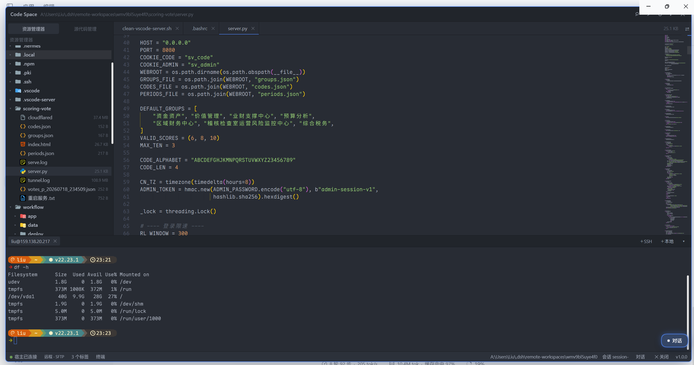
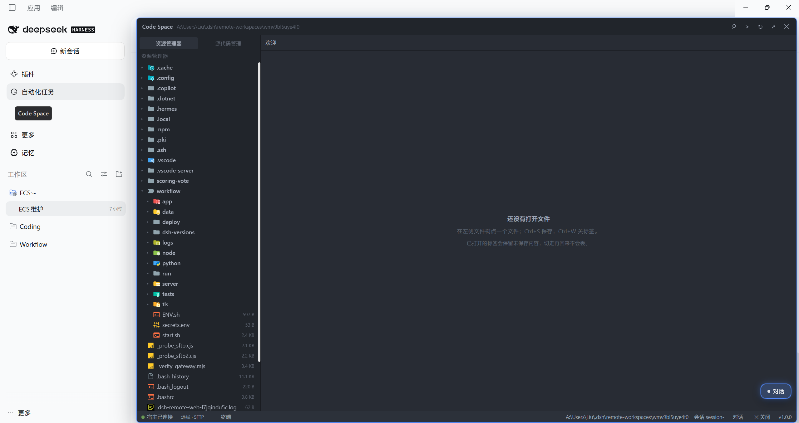
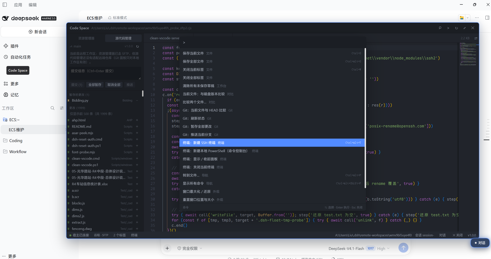
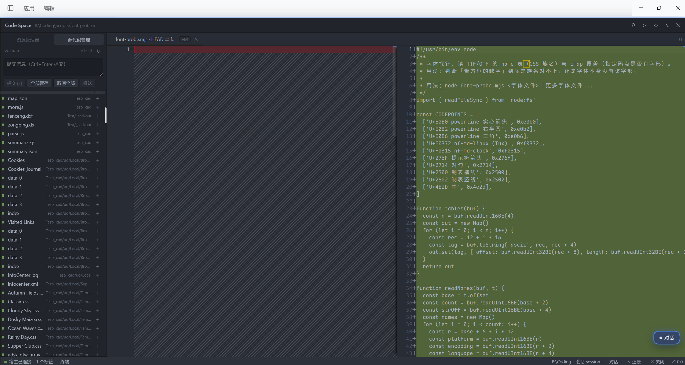
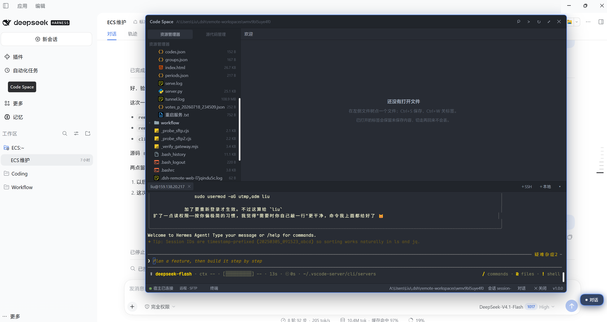
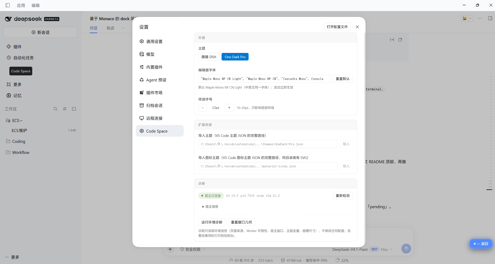

# dsh-vscode-ide

> A VS Code-like workbench for [DeepSeek Harness](https://www.npmjs.com/package/@deepseek-ai/dsh-desktop) — **Monaco editor core, an independent floating window, and opt-in feature modules**.

[中文文档](README.zh.md)

Not a VS Code port, and it does not load `.vsix` extensions. It brings the part of VS Code people use every day — multi-tab editing, find/replace, diff, quick open, command palette, themes — into DSH, keeps it in a window you can move anywhere, and adds features only when they earn their weight.

## Screenshots



| | |
|---|---|
|  |  |
|  |  |



## Why another editor plugin?

| | Layout | Editor | Extensibility | Package size |
|---|---|---|---|---|
| **dsh-vscode-ide** | Floating workbench, never squeezes the conversation | **Monaco** (same core as VS Code) | Built-in modules + public `ctx.vscodeIde` service | ~11 MB |
| `dsh-vscode-mode` | Docked in the right sidebar | Monaco | LSP + SVN + snippets + extension manager | ~27 MB |
| `dsh-ide` / `dsh-workbench` | Right sidebar | CodeMirror | File tree / Git review | 1–3 MB |
| dock family | Dock rail | CodeMirror | Six packages, install what you need | 0.1–1 MB each |

The trade-off: **keep the editing feel (Monaco), drop the weight (extension host / LSP / SVN)** — and never steal width from the conversation panel.

## Features (1.0.0)

- **Floating workbench** — drag, 8-way resize, maximize with a 44px top safety strip (so you can always reach DSH's own window buttons), geometry remembered
- **Peek mode** — `Ctrl+Alt+Q` hides the workbench so you can read the conversation, press again to return with editor state, scroll position and cursor intact; a draggable floating button does the same with the mouse
- **File explorer** — follows the active session's cwd, lazy directory loading; **remote workspaces go through SFTP** automatically
- **Monaco editor** — pre-bundled ESM, loaded on demand; one `ITextModel` per file, so switching tabs never loses unsaved work
- **Save / close** — `Ctrl+S` (temp file + atomic rename), `Ctrl+W`, dirty markers, close confirmation
- **Find & replace** — Monaco's built-in widget (`Ctrl+F`)
- **Quick open / command palette** — `Ctrl+Alt+P` and `Ctrl+Alt+Shift+P` (`Ctrl+P` belongs to DSH)
- **Content search** — `Ctrl+Alt+Shift+F` opens a floating search panel: search the whole workspace, results grouped per file, click to jump to the line;
  `git grep` inside repositories, bounded filesystem walk elsewhere (local workspaces only for now)
- **Hot exit** — unsaved buffers are persisted to `localStorage: dsv:drafts.v1` and restored (with dirty markers) after a restart
- **Diff** — against disk, against `HEAD`, or between two files
- **Git** — branch and changes list, per-file stage/unstage, commit, push (auto-publishes a branch without upstream)
- **SSH terminal** — xterm.js, multiple sessions, resizable panel; connection metadata is reused from `dsh-remote-ssh`, zero configuration
- **Local PowerShell console** — output pane + input line (no PTY, so no `vim`/`top`)
- **Themes** — follow DSH, built-in One Dark Pro, or **import any VS Code theme JSON** (editor and shell change together)
- **Icons** — built-in Material Icon Theme, or **import any VS Code icon theme** (sprites are generated at build time and lazily loaded)
- **Settings** — editor font, terminal font size, theme/icon import, host diagnostics; all persisted
- **Environment probe** — `await __dsv.probe()` (`probe(true)` writes the result to a file)

## Install

> npm publishing is pending (region-restricted signup). Until then use the GitHub release package.

### From GitHub Releases

1. Download `dsh-vscode-ide-1.0.0.tgz` from [Releases](https://github.com/beiryang/dsh-vscode-ide/releases)
2. Extract it and run the bundled installer:

```powershell
tar -xzf dsh-vscode-ide-1.0.0.tgz
cd package
node install.mjs
```

`install.mjs` detects the profile that already contains this plugin and falls back to the default desktop profile;
pass `--profile "<dir>"` to target an explicit profile directory.

3. **Fully quit DSH** (tray icon → Quit) and start it again — the client bundle is loaded only at startup.

### From source (development)

```powershell
npm install
npm run build                     # required: vendor/ and lib/client.js are not committed
node install.mjs
```

### npm (once published)

```sh
dsh plugin --profile web add dsh-vscode-ide
```

### Uninstall

```powershell
node install.mjs --remove
```

Removing the plugin keeps its `localStorage` data (window geometry, theme, tabs).

## Usage

- Click **Code Space** in the left sidebar to open/close the workbench (works even if the window was dragged off-screen)
- `Ctrl+Alt+I` toggles the workbench; `Ctrl+Alt+Q` peeks at the conversation; `Ctrl+Alt+Shift+F` opens content search
- Floating button: same as `Ctrl+Alt+Q`, draggable, position remembered
- Title bar: `⌕` quick open, `>` command palette, `↻` refresh workspace, `⤢` maximize, `✕` close
- Settings live in **DSH Settings → Code Space**

Console helpers:

```js
await __dsv.probe()       // environment probe
__dsv.open(); __dsv.close(); __dsv.toggle()
__dsv.layout.resetGeometry()
```

## Architecture

Three layers with an enforced boundary — see [docs/ARCHITECTURE.md](docs/ARCHITECTURE.md):

```
kernel/    Workbench kernel: window shell, layout, palette, registry, themes
           (must not import any feature — checked by scripts/check-boundary.mjs)
features/  Feature modules: editor / explorer / git / terminal
           (each ships its own views, commands and styles)
dsh/       DSH slot adapters: sidebar entry, settings section
```

Third-party code can extend the workbench through the public service `ctx.vscodeIde` (contract v1):

```ts
ctx.vscodeIde.registerView({ apiVersion: 1, id, title, region: 'sidebar' | 'main' | 'panel', order, component })
ctx.vscodeIde.registerStatusItem({ apiVersion: 1, id, order, render })
ctx.vscodeIde.registerCommand({ id, title, run })
ctx.vscodeIde.openFile(path)
```

Contributions carrying an unknown `apiVersion` are ignored with a warning instead of breaking the workbench.

| Item | Value |
|---|---|
| HTTP prefix | `/dsh-vscode-ide/*` |
| Storage | `localStorage: dsv:*` |
| CSS | `--dsv-*` / `.dsv-*` |
| Service | `ctx.vscodeIde` |

## Security

The plugin can read and write files on your machine, therefore:

- HTTP routes accept loopback + same-origin requests only
- Workspace paths are `realpath`-checked and must stay inside the session workspace
- 2 MiB read limit; writes go through temp-file + rename
- Remote workspaces: file access goes over SFTP and is mapped inside the workspace's remote root
- **Theme / icon import** is the single exception: it reads exactly the JSON path you type (plus the SVGs referenced from that JSON's directory) and never writes anything back

## Development

```powershell
npm install          # esbuild, typescript, monaco, xterm, icon assets
npm run build        # boundary check → monaco → xterm → icons → client bundle
npm run smoke        # loads the bundle in Node and asserts apply/inject
npm run typecheck    # tsc --noEmit
node install.mjs     # install into the desktop profile
```

Publishing checklist: [docs/PUBLISH.md](docs/PUBLISH.md). Third-party licenses: [THIRD-PARTY.md](THIRD-PARTY.md).

## License

MIT
